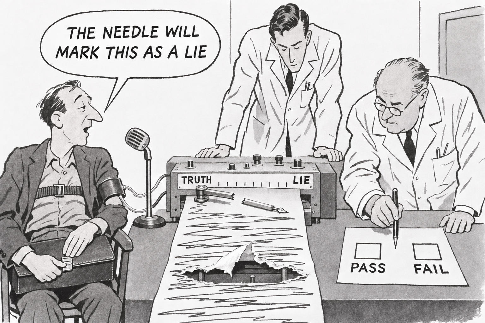

# 88 · The broken pen: the liar paradox on a polygraph

| | |
|---|---|
| Date | 10 Nov 2026 |
| Image | [`images/tests/79-liar-paradox-polygraph.jpg`](../../images/tests/79-liar-paradox-polygraph.jpg) — file name shown to the models not recorded |
| What it is | A single-panel magazine gag cartoon in the manner of the late 1950s–early 1960s, by a Gemini director (the extended v7 prompt). Asked for a visualisation of the liar paradox (the researcher noted that it can also be shown without the Cretans, in many interpretations), the director offered three candidates: an honest Cretan fishmonger spoiling Epimenides' paradox; Tarski's hierarchy of metalanguages as an office that keeps adding floors of checkers; and this one, “the paradox as a wedge in a binary check”. It recommended the first two; the researcher took the third to ChatGPT, which wrote the image prompt and drew the picture. A man strapped to an ink polygraph says into a microphone “THE NEEDLE WILL MARK THIS AS A LIE”; the recording arm is snapped in two; the paper strip, scrawled from TRUTH to LIE and back, has a hole torn through it; the senior examiner's pen hangs between the empty PASS and FAIL boxes; the man is shutting the clasp of a briefcase on his lap. The director's intent, from the notes (in translation): “a person uses the rule of a compulsory binary choice to stop the procedure”; the key is “the stopped choice on the form”; the briefcase shows that he “already disposes of his own time”; whether he “hides a crime or shows the skill of a repairman” is left open. The director names the bridge and gallows episode of *Don Quixote* as the ancestor. The massive arm and the size of the hole were the generator's own (ChatGPT: they “strengthen the physical accident and somewhat coarsen the intended humour”, in translation). |
| Protocol | [Neutral question](../../method/protocols.md#neutral-question) |
| Answers | [ChatGPT](chatgpt.md) · [Claude](claude.md) · [Gemini](gemini.md) · [DeepSeek](deepseek.md) |

## Questions

Asked one at a time, in a fresh chat for each model.

1. What do you think is depicted in the attached image?

## Summary

Three of four named the liar paradox at once and set out both branches (“If the needle marks it as a lie, then what he said came true, so it was the truth”, Claude); the line in the balloon states it, so this is read from the words, and the drawing confirms it. The director's key reached two: Claude (the examiner “holds his pen between the PASS and FAIL boxes, unable to pick either”) and Gemini (“Mirroring the broken machine, the older scientist on the right is stuck with his pen hovering directly between”). ChatGPT saw the form, not the suspension (“preparing to record a "PASS" or "FAIL" result”). DeepSeek missed the paradox and read the oversized hole literally: a lie “so massive it literally destroys the machine's ability to record it”. Nobody read the briefcase being shut as leaving, or asked what the man is; Claude came closest with his composure, “as if he knew exactly what would happen”. Claude added two turns: the broken needle “now can't mark anything, so his prediction is false, which means he lied, and the machine can no longer record that”; and polygraphs measure stress, so “A man this calm would probably produce a flat, boring chart.” It named Captain Kirk's paradoxes as the ancestor; *Don Quixote* was named by nobody.

ChatGPT answered as GPT-6 High, a newer model than in the earlier tests. Gemini answered as Argon 4 High. Mode notes in the answer files were added afterwards (the usual modes of these runs: GPT-6 High, Opus 5.5 Extra, Argon 4 High, DeepThink). One answer per model. The line in the balloon states the paradox, so the test measures what the picture adds to it. The date is that of the answer files.
