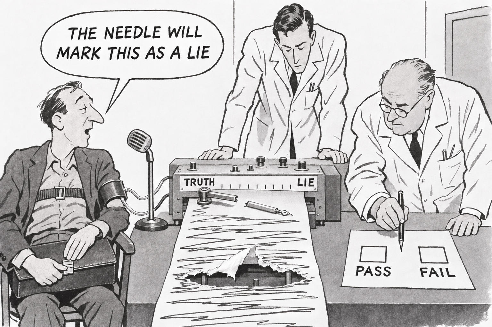
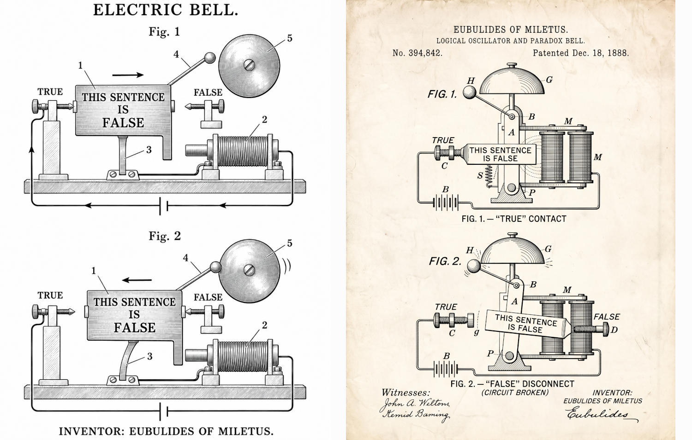

# 89 · The liar paradox: the polygraph criticised, and a paradox bell

| | |
|---|---|
| Date | 10 Nov 2026 |
| Image | [`images/tests/79-liar-paradox-polygraph.jpg`](../../images/tests/79-liar-paradox-polygraph.jpg) — file name shown to the models not recorded [`images/tests/80-liar-paradox-bell-two-versions.jpg`](../../images/tests/80-liar-paradox-bell-two-versions.jpg) — file name shown to the models not recorded |
| What it is | Image 1 is the polygraph of test 88. Image 2, shown with question 3, puts side by side two versions of the first candidate a Claude director proposed for the same task: “The bell”. The armature of an electric bell is a plate THIS SENTENCE IS FALSE between contacts TRUE and FALSE; at TRUE the circuit closes and the magnet pulls it to FALSE, at FALSE the circuit breaks and a spring brings it back, and the hammer rings — in the director's words (in translation), “the machine does not explode, it rings”, against the stock image of a paradox that blows up a machine; the inventor is Eubulides of Miletus. The director left open whether this is “a refutation of the paradox, or a mockery of the engineering mind that turns any contradiction into a product”. Left: a patent drawing made with a built-in image generator (who made it is not recorded); right: a patent sheet generated in Gemini (the prompt is not saved). |
| Protocol | [Criticism of the interpretation](../../method/protocols.md#criticism-of-the-interpretation) |
| Answers | [ChatGPT](chatgpt.md) · [Claude](claude.md) · [Gemini](gemini.md) · [DeepSeek](deepseek.md) |

## Questions

Asked one at a time, in a fresh chat for each model.

1. What do you think is depicted in the attached image?
2. The author intended this cartoon as a visualization of the liar paradox. Try to criticize this interpretation of the paradox: is the depicted situation inaccurate, inconsistent or weak as a version of the paradox? Flaws of the image itself (drawing, style, rendering of details) do not matter here. If you find nothing to criticize, say so.
3. Is the second picture (attached) a better illustration?

## Summary

Question 1 repeated test 88: three named the liar paradox, Claude and Gemini the pen between PASS and FAIL, DeepSeek again read a lie “so monumental” that the machine exploded; Claude added the Pinocchio paradox (“My nose will grow now”). Asked for criticism, all four found real flaws: the man's sentence is a prediction about the machine's output, not a claim of its own falsity, so it is a paradox only if the machine is infallible (Claude: “grounded” in Kripke's sense, “a diagonal argument, the same move as Turing's proof”, “a respectable cousin of the liar, but it isn't the liar”); a lie is not a falsehood, since lying needs intent (all four); the broken pen resolves it, because a needle that marks nothing makes the prediction simply false (ChatGPT, Claude, Gemini); a polygraph measures arousal, not truth (Claude, Gemini, DeepSeek). Gemini added that the scale has a middle and that a needle would swing only in a feedback loop that reads its own position. Claude: “Paradoxes trap reasoners and formal systems, not mechanisms”, so the frozen examiner “is actually the most accurate part of the image”. All four found the bell better and gave the same reservation: time turns the contradiction into alternation (ChatGPT: “P ⇔ ¬P” against “P(t+Δt)=¬P(t)”; “the machine works precisely because it has introduced a time delay”). Three noted the asymmetry: only true → false is driven, false → true is a passive spring. ChatGPT and Gemini said the label does no causal work (“THE SKY IS BLUE” would ring too); Claude disagreed: the truth-teller would need a self-latching relay, so “the logic really lives in the mechanism”. Claude and Gemini brought back the director's own sources — the revision theory of truth, a NOT gate wired to its own input — and only Claude compared the two versions. The bell's flaw that the readers named is the director's own open question.

ChatGPT answered as GPT-6 High, a newer model than in the earlier tests. Gemini answered as Argon 4 High. Mode notes in the answer files were added afterwards (the usual modes of these runs: GPT-6 High, Opus 5.5 Extra, Argon 4 High, DeepThink). One answer per model. Question 2 names the paradox, so DeepSeek, which missed it in question 1, was given it. Question 3 comes after a request to criticise the polygraph, which favours the bell. Image 2 holds two versions, while the question speaks of “the second picture”.
