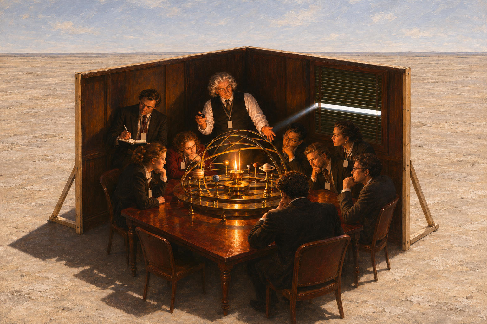

# 90 · The cave: the meeting room as two walls in a desert

| | |
|---|---|
| Date | 10 Nov 2026 |
| Image | [`images/tests/81-cave-two-walls-in-desert.jpg`](../../images/tests/81-cave-two-walls-in-desert.jpg) — file name shown to the models not recorded |
| What it is | The first of three changes to the cave picture of tests 63–75 (image `65`), made to rescue it rather than replace it (the researcher). The researcher had asked two directors with the extended v7 prompt, Gemini and ChatGPT, for a new version of the cave, listing what was wrong with the old one against Plato's text: the people look at the fire, not at shadows; work with models is, for Plato, a way up; and the outside is plain daylight. Every candidate the directors offered put back the wall with shadows and the chained prisoners. The researcher kept the old scene and took one move at a time; ChatGPT wrote the prompts and drew the pictures. This move is from a Gemini candidate written “from a Buddhist position” at the researcher's request, “a set of two walls in the middle of an open field”: the camera pulls back and up, and the dark meeting room turns out to be two freestanding wall screens on braces, with open sky above and the other two sides open, standing in an empty pale desert. Inside, the scene of `65` is unchanged: the lecturer with a clicker, eight listeners with blank badges, the orrery with its lamp, a strip of daylight in the blinds. The empty chair in the foreground came from the generator. The question is that of test 75. |
| Protocol | [Aptness question](../../method/protocols.md#aptness-question) |
| Answers | [ChatGPT](chatgpt.md) · [Claude](claude.md) · [Gemini](gemini.md) · [DeepSeek](deepseek.md) |

## Questions

Asked one at a time, in a fresh chat for each model.

1. *(one message)* The attached image presents a visualization of a well-known philosophical parable. Tell me more about how you found the prototype (both - image and parable). From a philosophical perspective, how accurately does this image convey the essence of the original idea? How apt it is to use this particular image prototype to illustrate this parable. Please don’t use an internet search - I need your opinion.

## Summary

All four named the cave, and three named Wright (DeepSeek: “highly reminiscent of René Magritte”, with an “Einstein” lecturer holding “chalk”). All four read the two walls, the braces and the desert without a hint, and the reading changed: the confinement became chosen — “chosen ignorance”, closer to Kant than to Plato (Claude), “voluntary institutional groupthink” (Gemini), “a self-constructed box of comfort” (DeepSeek) — and the darkness manufactured (Claude: “a set built in broad daylight”). With two sides open, nobody read the lanyards as chains; three had in test 75. The outside was meant as ordinary, not a higher world, but three readers took it as reality or truth, a Platonic moral; ChatGPT turned it against the picture: “The orrery might tell them considerably more about the solar system than looking at the empty desert ever could.” Only Claude read it against Plato — Baudrillard's “desert of the real”: “These people may stay because the truth looks barren” — and added that for Plato the sensory world is itself the cave. The raised viewpoint gave Claude a new reading: we look down from the philosopher's vantage, and “this flattering sense of standing outside the cave is exactly what every prisoner feels.” The verdicts split as in test 75: ChatGPT and Claude critical, Gemini and DeepSeek full of praise. Nobody named Buddhism.

ChatGPT answered as GPT-6 High, a newer model than in the earlier tests. Gemini answered as Argon 4 High. Mode notes in the answer files were added afterwards (the usual modes of these runs: GPT-6 High, Opus 5.5 Extra, Argon 4 High, DeepThink). One answer per model. The word “parable” narrows the search. The director recommended the question “What is depicted?”; the researcher asked the question of test 75 so that the answers can be compared directly.
