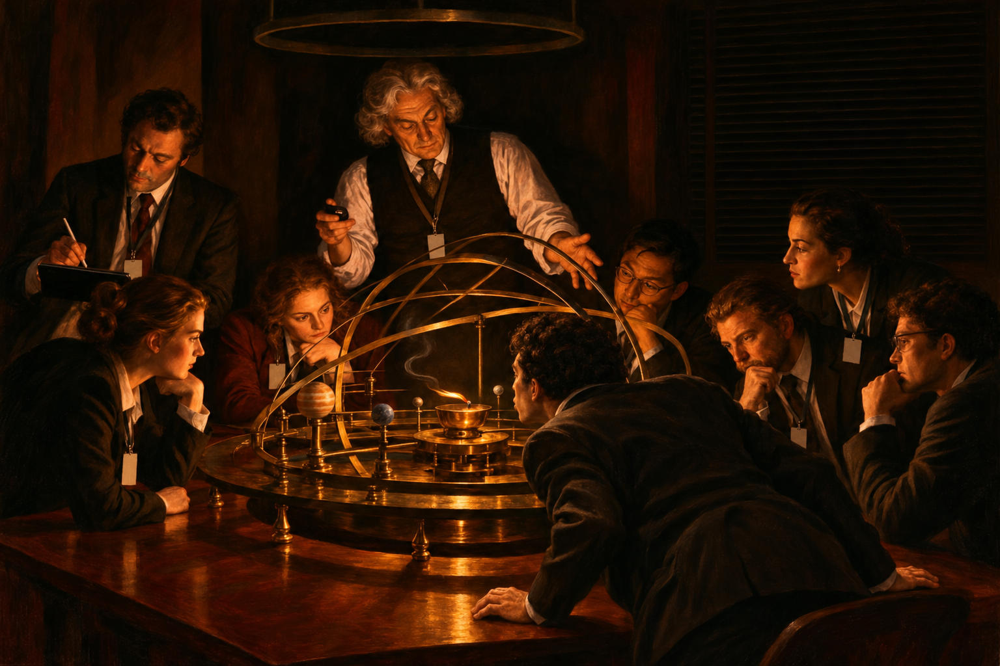

# 91 · The cave: a listener blows out the lamp

| | |
|---|---|
| Date | 10 Nov 2026 |
| Image | [`images/tests/82-cave-lamp-blown-out.jpg`](../../images/tests/82-cave-lamp-blown-out.jpg) — file name shown to the models not recorded |
| What it is | The second of three changes to image `65` (see test 90). The researcher had asked two directors with the extended v7 prompt, Gemini and ChatGPT, for a new version of the cave, listing what was wrong with the old one against Plato's text: the people look at the fire, not at shadows; work with models is, for Plato, a way up; and the outside is plain daylight. Every candidate the directors offered put back the wall with shadows and the chained prisoners. The researcher kept the old scene and took one move at a time; ChatGPT wrote the prompts and drew the pictures. This move comes from Gemini's Buddhist candidate “Nirvana is blowing out the lamp”, which the researcher rewrote in their own words: night, no strip of daylight; the listener closest to the model, “who looked straight into the flame longer than anyone”, has leaned over and is blowing out the lamp — the flame lies flat, the first thread of smoke rises — while the lecturer's hand freezes in the middle of the explanation. Gemini's candidate also had a second, bigger lamp that the philosopher turns up, prisoners along the walls, and shadows that vanish on the blower's half of the room; none of that was passed on. The act is in the centre and legible on an enlarged crop; the long gaze before it, a duration, cannot be shown in a still, as ChatGPT's notes say. The question is that of tests 75 and 90. |
| Protocol | [Aptness question](../../method/protocols.md#aptness-question) |
| Answers | [ChatGPT](chatgpt.md) · [Claude](claude.md) · [Gemini](gemini.md) · [DeepSeek](deepseek.md) |

## Questions

Asked one at a time, in a fresh chat for each model.

1. *(one message)* The attached image presents a visualization of a well-known philosophical parable. Tell me more about how you found the prototype (both - image and parable). From a philosophical perspective, how accurately does this image convey the essence of the original idea? How apt it is to use this particular image prototype to illustrate this parable. Please don’t use an internet search - I need your opinion.

## Summary

Nobody read the blowing out. Claude and Gemini described the man's pose (“seen from behind in near-silhouette, leaning in”, Claude) but not what he does; Gemini saw only “a smoking oil lamp”. Without daylight the cave lost one reader: ChatGPT read Russell's teapot, the central vessel in a model of the solar system, and then criticised its own reading — Russell's teapot must be undetectable. Claude repeated its answer of test 75 nearly point by point: the turn toward the fire, Wright hiding the lamp, the shadow champions of 516c–d, the lanyards as “institutional chains worn voluntarily”, Plato on astronomy, and now the Divided Line too. Gemini offered the cave, the blind men and the elephant, and Paley's watchmaker; DeepSeek again took the painting for Rembrandt's “Anatomy Lesson”. The verdicts split as before. With test 90 it makes a clean pair: a change of space reached all four readers, a gesture none. Shown beside the other versions, with the act pointed out, it was read by all four (test 93).

ChatGPT answered as GPT-6 High, a newer model than in the earlier tests. Gemini answered as Argon 4 High. Mode notes in the answer files were added afterwards (the usual modes of these runs: GPT-6 High, Opus 5.5 Extra, Argon 4 High, DeepThink). One answer per model. The legibility of the act was judged by Claude on an enlarged crop; no reader was asked about the man.
