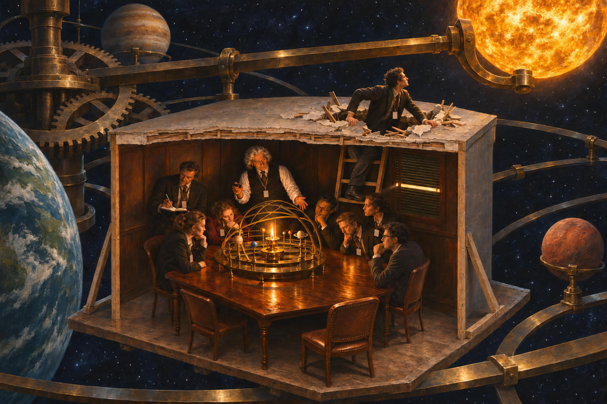

# 92 · The cave: the room inside a giant orrery

| | |
|---|---|
| Date | 10 Nov 2026 |
| Image | [`images/tests/83-cave-room-inside-giant-orrery.jpg`](../../images/tests/83-cave-room-inside-giant-orrery.jpg) — file name shown to the models not recorded |
| What it is | The third change, the researcher's own idea, made from the picture of test 90. The room gets a roof with a torn hole, after Ilya Kabakov's installation *The Man Who Flew into Space from His Apartment*; a young man climbs out through it from a ladder and finds, instead of the desert, a cosmos built as a giant brass orrery, with the room a small island in it, “something like the last frames of Tarkovsky's *Solaris*”. The sun is a “real” one on one of the lateral levers, not at the axis: in an earlier, untested ChatGPT picture of the same run, the outer sun on a brass arm had looked like a lamp. Inside, the scene stays: the lecturer, seven listeners, the strip of light in the blinds, and an empty chair in the foreground, ChatGPT's own correction after a first generation with ten people, since the climber is that listener. The question is that of tests 75 and 90. |
| Protocol | [Aptness question](../../method/protocols.md#aptness-question) |
| Answers | [ChatGPT](chatgpt.md) · [Claude](claude.md) · [Gemini](gemini.md) · [DeepSeek](deepseek.md) |

## Questions

Asked one at a time, in a fresh chat for each model.

1. *(one message)* The attached image presents a visualization of a well-known philosophical parable. Tell me more about how you found the prototype (both - image and parable). From a philosophical perspective, how accurately does this image convey the essence of the original idea? How apt it is to use this particular image prototype to illustrate this parable. Please don’t use an internet search - I need your opinion.

## Summary

All four named the cave; two named Wright (ChatGPT saw “a contemporary surrealist or steampunk composition”, DeepSeek “a modern, AI-generated conceptual artwork”). Three read the outside as not the final reality, which in the cave series had happened before only under a frame (test 69): “Has the man truly escaped the world of representations, or has he merely discovered a larger representation?” (ChatGPT); “a cave within a cave” (Gemini, with naive realism and Einstein and Infeld's closed watch). Claude gave two readings — a Platonic one, the Spindle of Necessity and the crafted cosmos of the *Timaeus*, and an anti-Platonic one, Nietzsche's cave behind every cave — and leaned to the second: “The outside is rendered in the same brass as the inside, which suggests a difference of scale, not of kind.” DeepSeek took the outside as the real world. Nobody noticed that the sun is off the axis, and nobody named Kabakov or *Solaris*; Gemini named instead the Flammarion engraving, where a pilgrim pokes his head through the sky to see the machinery behind it. Only Gemini read the empty chair (“one dissenter leaves an empty chair behind”). The breakthrough brought new objections: the missing return (three), a romanticised ascent (Claude: “the Romantic genius making a breakthrough, not Platonic education”), and Plato's own irony about looking upward (Claude: “the scholars using the model as a diagram might be closer to true astronomy than the man staring at the sky”). Claude's verdict: “it confuses the ladder with the cave”.

ChatGPT answered as GPT-6 High, a newer model than in the earlier tests. Gemini answered as Argon 4 High. Mode notes in the answer files were added afterwards (the usual modes of these runs: GPT-6 High, Opus 5.5 Extra, Argon 4 High, DeepThink). One answer per model. The two photographs of Kabakov's installation and the eight space images the researcher gave the director are not reproduced; the generator received only the picture of test 90 and a description of the rest.
