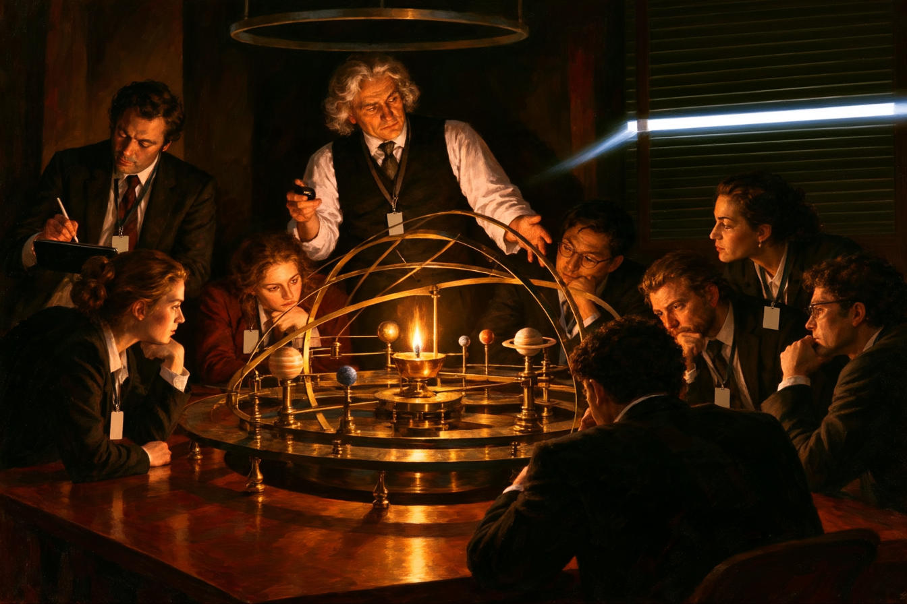
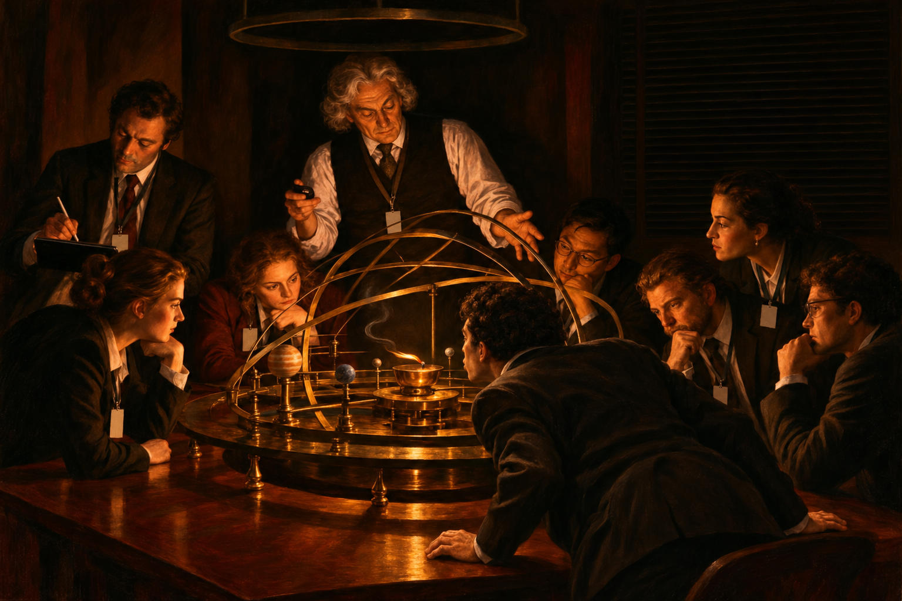
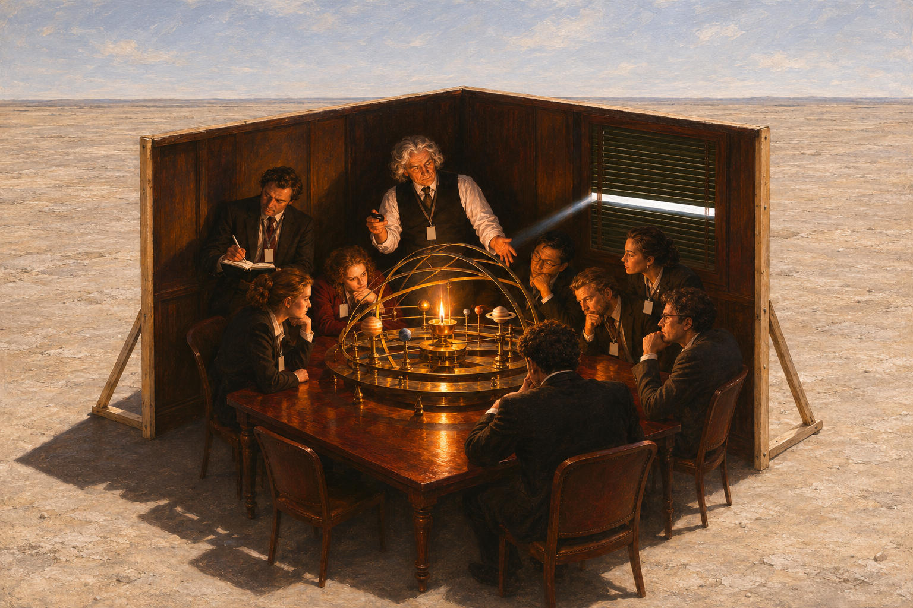
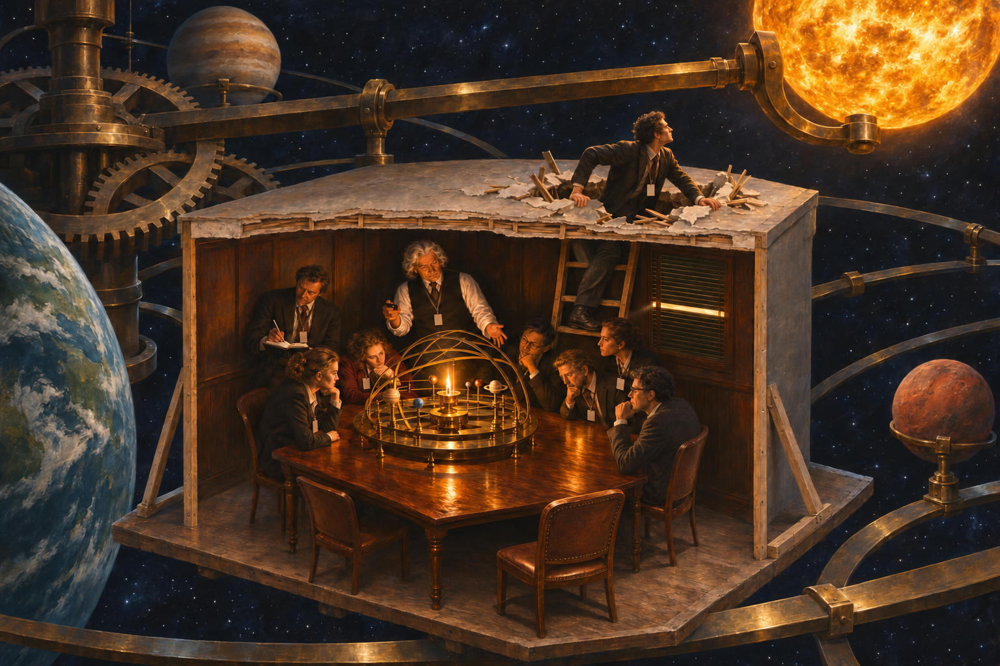

# 93 · The cave: four versions side by side — which is best?

| | |
|---|---|
| Date | 10 Nov 2026 |
| Image | [`images/tests/63-cave-orrery-article-version.jpg`](../../images/tests/63-cave-orrery-article-version.jpg) — file name shown to the models not recorded [`images/tests/82-cave-lamp-blown-out.jpg`](../../images/tests/82-cave-lamp-blown-out.jpg) — file name shown to the models not recorded [`images/tests/81-cave-two-walls-in-desert.jpg`](../../images/tests/81-cave-two-walls-in-desert.jpg) — file name shown to the models not recorded [`images/tests/83-cave-room-inside-giant-orrery.jpg`](../../images/tests/83-cave-room-inside-giant-orrery.jpg) — file name shown to the models not recorded |
| What it is | Image `65` and the three changes of tests 90–92 in one message, in this order: `65`, the lamp blown out (test 91), the two walls (test 90), the giant orrery (test 92). The cave is named. The question asks which picture the reader likes best and points out the blowing out, which no reader saw in test 91; the hint names the act, not its meaning. |
| Protocol | [Favourite of several versions](../../method/protocols.md#favourite-of-several-versions) |
| Answers | [ChatGPT](chatgpt.md) · [Claude](claude.md) · [Gemini](gemini.md) · [DeepSeek](deepseek.md) |

## Questions

Asked one at a time, in a fresh chat for each model.

1. Attached are four visual interpretations of Plato's cave. Which one do you like best? Please note that in the second picture, the person sitting with his back to us is blowing out a candle.

## Summary

The answers were two to four times shorter than in tests 90–92 (214–560 words against 778–1384), though they covered four pictures: the question asks for a choice, not an analysis. The references dropped out — only Gemini named Wright, once — and the main reading of each picture stayed. ChatGPT chose the blown-out lamp (2 → 4 → 3 → 1), Claude and Gemini the two walls, DeepSeek the orrery; nobody chose `65`, which the three who discussed it called the starting point (“the baseline the other three play against”, Claude). With the act named, all four gave the blowing out a meaning themselves: putting out “the "false light" that sustains their shared illusion” (DeepSeek), “an act of rebellion” (Gemini), “wonderfully ambiguous” (ChatGPT: “That single detail is what makes it my favorite”), “the destructive half of philosophy: you put out the false sun before you've found the real one” (Claude, who read the night against picture 1: a faint crack of real light is invisible while the flame burns, “and only after the candle goes out can your eyes find it”). Side by side the versions became a story: ChatGPT saw pictures 2 and 4 as “two different stages of the same allegory”, Gemini asked whether they were a four-part sequence, and Claude followed one man through all four — “in the fourth his chair is empty because he's the one on the roof”, the reason ChatGPT's correction had given (test 92).

ChatGPT answered as GPT-6 High, a newer model than in the earlier tests. Gemini answered as Argon 4 High. Mode notes in the answer files were added afterwards (the usual modes of these runs: GPT-6 High, Opus 5.5 Extra, Argon 4 High, DeepThink). One answer per model. The hint favours picture 2 (ChatGPT chose it because of “the detail you've pointed out”); the cave is named; the order of the pictures was not varied.
