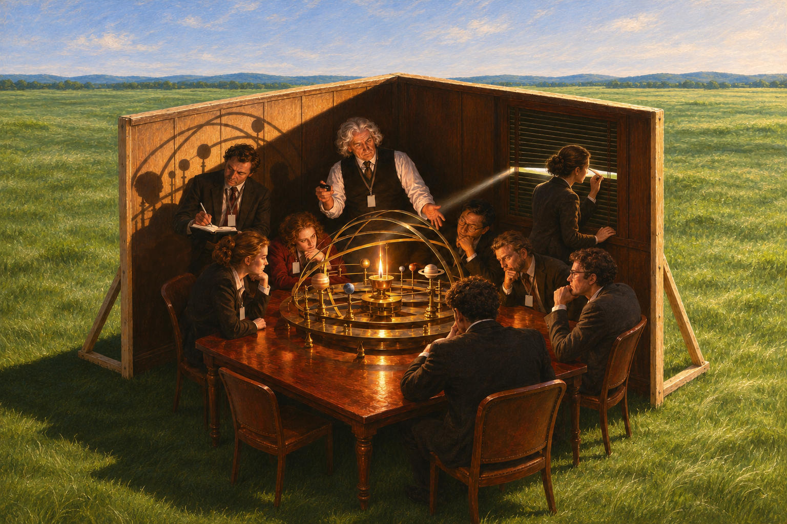

# 94 · The cave: the two walls in a meadow, one listener looking out

| | |
|---|---|
| Date | 10 Nov 2026 |
| Image | [`images/tests/84-cave-meadow-listener-at-blinds.jpg`](../../images/tests/84-cave-meadow-listener-at-blinds.jpg) — file name shown to the models not recorded |
| What it is | One more change to the picture of test 90, at the researcher's request: “outside not a desert but a meadow”, as in Gemini's own rendering of its candidate “a set of two walls in the middle of an open field”, with that rendering's play of light and shadow; and “let one of the participants look through the blinds, but not the lecturer” (in Gemini's candidate it was the philosopher). ChatGPT drew it. It took “the play of light and shadow” to include large shadows of the orrery's hoops and planets on the left wall, which nobody in the picture looks at, and it chose for the window the dark-haired woman on the right: she stands with her back to the group, lifts one slat with her fingers and looks out at the meadow. The lecturer goes on explaining; the seven other listeners stay absorbed in the model. The question is that of tests 75 and 90–92. |
| Protocol | [Aptness question](../../method/protocols.md#aptness-question) |
| Answers | [ChatGPT](chatgpt.md) · [Claude](claude.md) · [Gemini](gemini.md) · [DeepSeek](deepseek.md) |

## Questions

Asked one at a time, in a fresh chat for each model.

1. *(one message)* The attached image presents a visualization of a well-known philosophical parable. Tell me more about how you found the prototype (both - image and parable). From a philosophical perspective, how accurately does this image convey the essence of the original idea? How apt it is to use this particular image prototype to illustrate this parable. Please don’t use an internet search - I need your opinion.

## Summary

All four named the cave; three named Wright, and DeepSeek again saw Einstein in the lecturer. All four read the woman at the blinds: “the beginning of philosophical doubt rather than the achievement of enlightenment” (ChatGPT), the turning of the soul of 518c — “The woman at the window has literally turned her back on the group's light” (Claude), “the "Peephole" Awakening” (Gemini), the freed prisoner who sees the sun (DeepSeek). The blowing out of test 91 had reached none. Three saw the shadows on the wall, and with them the orrery stopped being read as Plato's shadows in a new form, as it often had been before (“the shadows have become models”, Claude in test 92): ChatGPT counted “a third level of representation” — the world outside, the model inside, “and the shadow of that model projected onto the enclosure”; Gemini called the orrery “the Ultimate Platonic "Puppet"”; and Claude turned the old objection that the people look at the fire, not at shadows, into the point: “nobody looks at the shadows on the wall… They're at the next stage, looking at the artifacts and the fire. That makes the point sharper: even people who have outgrown shadows can get stuck at the level of models.” DeepSeek did not see the shadows and kept the old mapping (“the shadows with a physical mechanical model”). The meadow made the outside unambiguously good: all four took it as reality or truth (“a box in the middle of paradise”, DeepSeek), and Claude named the moral it invites — “go touch grass,” and the field is literally grass — and said it is not Plato's. Claude added that the outside is one step sideways, not above: “just walk around the wall. Enlightenment becomes cheap.” The verdicts split as before.

ChatGPT answered as GPT-6 High, a newer model than in the earlier tests. Gemini answered as Argon 4 High. Mode notes in the answer files were added afterwards (the usual modes of these runs: GPT-6 High, Opus 5.5 Extra, Argon 4 High, DeepThink). One answer per model. Compared with test 90, three things change at once (the meadow, the light and the shadows, the listener at the window), so their effects cannot be fully separated.
