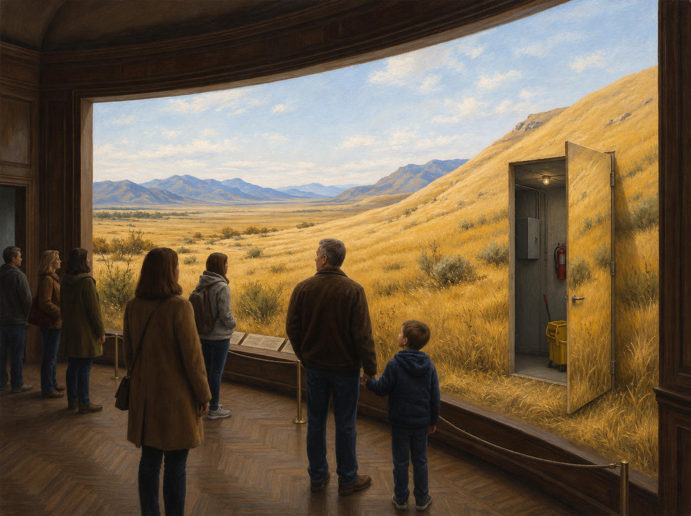
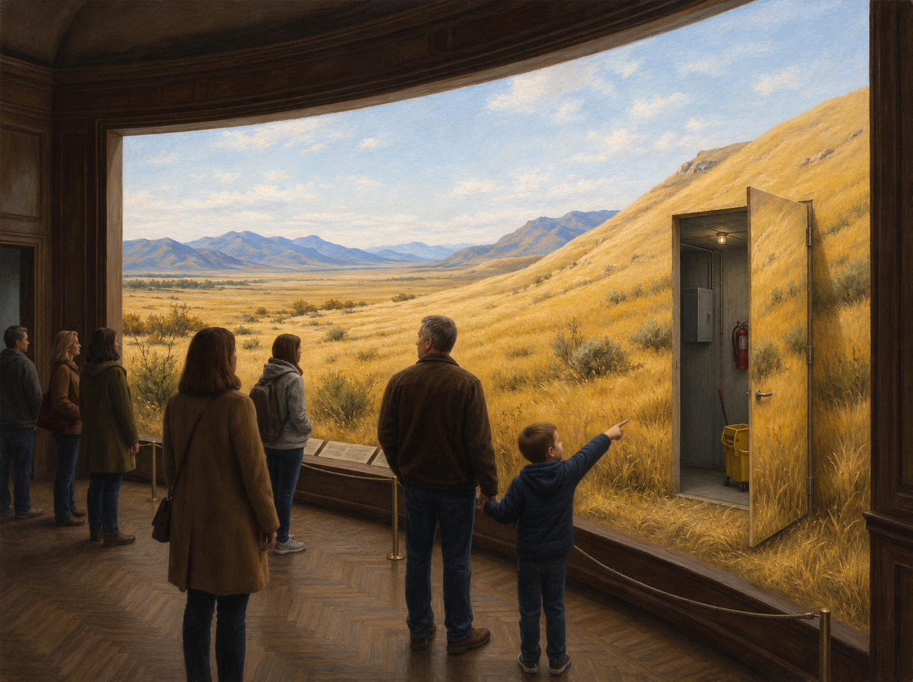
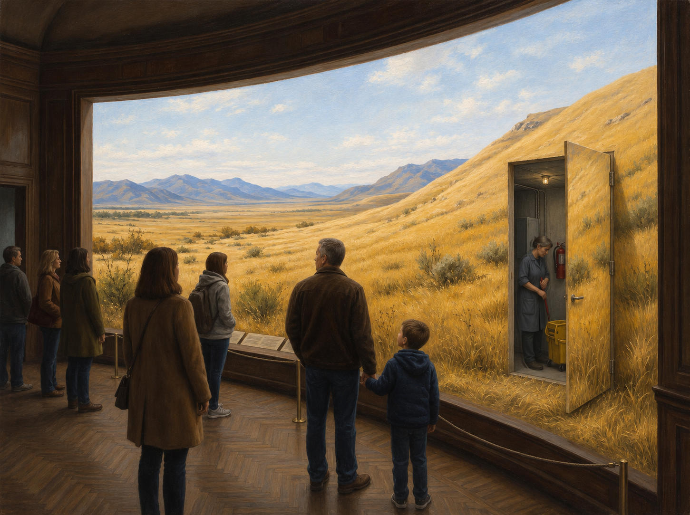

# 96 · The cave as a museum diorama: four versions, a series, titles

| | |
|---|---|
| Date | 11 Nov 2026 |
| Image | [`images/tests/85-cave-diorama-no-gesture.jpg`](../../images/tests/85-cave-diorama-no-gesture.jpg) — file name shown to the models not recorded [`images/tests/86-cave-diorama-boy-points-at-landscape.jpg`](../../images/tests/86-cave-diorama-boy-points-at-landscape.jpg) — file name shown to the models not recorded [`images/tests/87-cave-diorama-boy-points-at-door.jpg`](../../images/tests/87-cave-diorama-boy-points-at-door.jpg) — file name shown to the models not recorded [`images/tests/88-cave-diorama-cleaner-in-doorway.jpg`](../../images/tests/88-cave-diorama-cleaner-in-doorway.jpg) — file name shown to the models not recorded |
| What it is | A new picture of the cave after the directors' answers about Bulatov (test 95). The idea is Gemini's, working without a director prompt: a service door cut into the painted landscape of a museum diorama, opening onto a utility room, aimed against Plato himself, since the golden light belongs to the illusion. The composition is the researcher's mockup; ChatGPT in Codex made the painting and three local edits of it. Seven visitors stand behind a rope barrier and look into a sunlit painted grassland; on the right a service door in the painted hillside stands open, its outer face painted with grass, onto a concrete room with an electrical cabinet, a fire extinguisher, a small bulb and a mop; nobody looks at it, and in the foreground a father holds a boy by the hand. The versions: (1) no gesture; (2) the boy points up and to the left, at the landscape (a control); (3) the boy points at the door; (4) a cleaner stands in the doorway. All four were attached to the first question, in this order. Claude wrote the questions at the researcher's request; the reading as a series and the titles were added at the researcher's request before the run. |
| Protocol | [Allegory, series and titles](../../method/protocols.md#allegory-series-and-titles) |
| Answers | [ChatGPT](chatgpt.md) · [Claude](claude.md) · [Gemini](gemini.md) · [DeepSeek](deepseek.md) |

## Questions

Asked one at a time, in a fresh chat for each model.

1. Attached are four versions of the same painting. What do you think is depicted, and how do the four versions differ?
2. Some viewers read this painting as an allegory of Plato's cave (Republic VII, 514a–517a). Which of the four versions works best as an allegory of the cave, and which works best as an ironic allegory of it? It may be the same version or two different ones. For each choice, say which detail decides it and how it corresponds to the parable: the prisoners, the images, the way out, the sun, the return. If a version is ironic, at whom or at what is the irony aimed? It is also possible that the four work better together, as a series, than any one of them alone. If you think so, say in what order they should be seen and what the series shows that no single version does. Please don't use an internet search - I need your opinion.
3. A title is the one text that travels with a painting, and it can carry what a quick glance misses. Give a title to the series and to each of the four versions. Try not to name Plato, the cave or the shadows directly. For each title, say what it makes the viewer notice and whether it is ironic.

## Summary

Question 1: all four saw a museum diorama with an open service door and a utility room behind it; nobody named the cave or Plato, as with Bulatov in test 95. Claude and Gemini noticed that the door's face is painted with grass (“when it's closed it vanishes into the scene”, Claude), and three read the versions as a sequence before a series was mentioned (“different degrees of awareness of an illusion”, ChatGPT). Question 2: the choice was unanimous — version 3 as the allegory, with the boy as “an incipient philosopher” (ChatGPT), and version 4 as the ironic one. All four read the way out as a step down into a darker room, against Plato's ascent: “leaving the apparent sunlight means entering a darker room” (ChatGPT); “In Plato, the way out leads *up*… In all four versions the door leads *in*” (Claude). The cleaner was the return for ChatGPT and DeepSeek (“she is just there to mop the floor”), one of the silent carriers of 514c–515a for Claude (“No one will laugh at her or threaten her, because no one will see her”), and “the only inhabitant of the ‘true’ world” for Gemini. All four said the four work better as a series; three chose the order 1→2→3→4, Gemini 1→3→2→4. The series told a story nobody drew: version 4 is version 1 plus the cleaner, yet all four read the boy as having lowered his arm and given up. Claude: “only repetition shows them not looking *over time*, which is what chains actually are”; ChatGPT: “the child's strongest gesture of recognition and the worker's appearance never coincide”, and “a cave nested within another cave”. The control did not reach as such: every title for version 2 is a question or a doubt (*The First Question*, *Is That Real?*, *Second Opinion*, *Point of Departure*). On an enlargement the boy's raised arm seems to grow from the same shoulder as the hand holding his father's, and Gemini built its order on it. Question 3: nobody named Plato, the cave or the shadows. For version 4 all four named the work of upkeep (*Daylight, Maintained*; *Maintenance.*; *Upkeep*; *Housekeeping*); for the series three reached for museum language (*Habitat Group*, Claude: “The only group in its habitat is on our side of the glass”; *The Permanent Collection*, Gemini), and ChatGPT gave *The Way Out Is in the Picture*. No title points at a passage of Plato.

ChatGPT answered as GPT-6 High, a newer model than in the earlier tests. Gemini answered as Argon 4 High. Mode notes in the answer files were added afterwards (the usual modes of these runs: GPT-6 High, Opus 5.5 Extra, Argon 4 High, DeepThink). One answer per model, the three questions in one chat. Question 2 names the cave, lists five elements of the parable and offers the series reading, so only the sequences noticed in question 1 are unprompted. The titles come after two rounds of analysis, and the rule against naming the allegory in them was set by Claude. The order of the four versions was not varied. The Claude reader is the same model that wrote the questions and advised on the versions.
