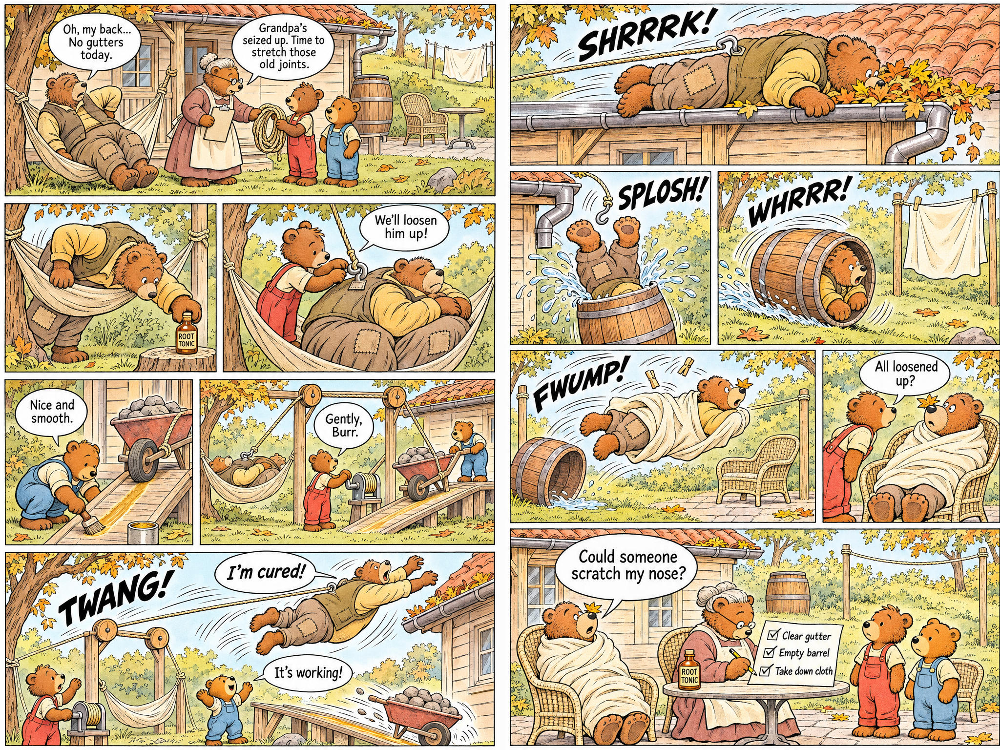
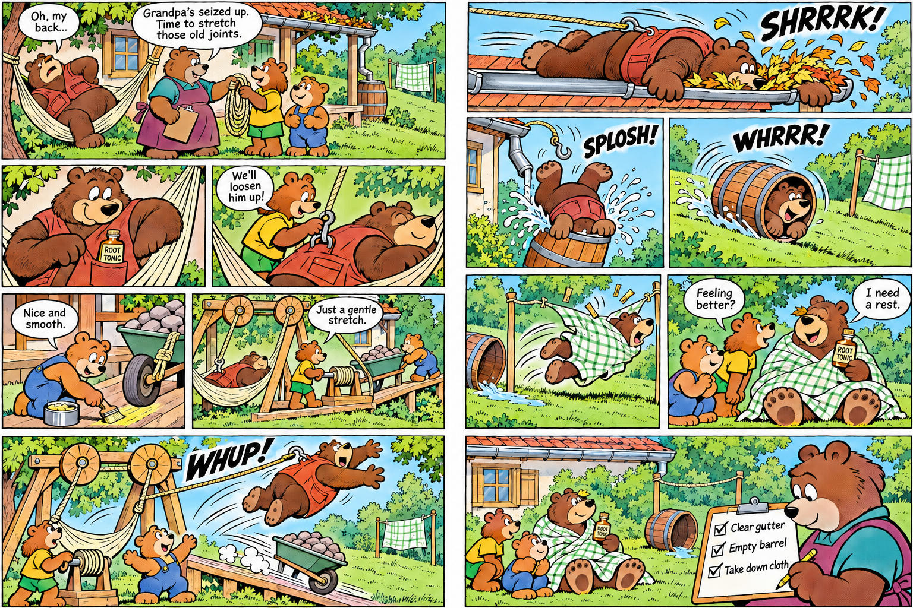
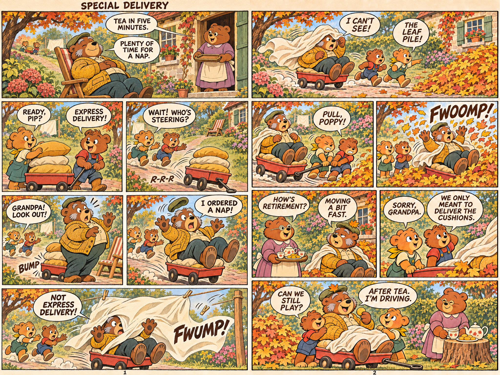

# 97 · Three bear comics: creativity of content and form, then the brief

| | |
|---|---|
| Date | 19 Nov 2026 |
| Image | [`images/tests/89-bears-nettle-burr-pen-and-watercolour.jpg`](../../images/tests/89-bears-nettle-burr-pen-and-watercolour.jpg) — file name shown to the models not recorded [`images/tests/90-bears-nettle-burr-franco-belgian.jpg`](../../images/tests/90-bears-nettle-burr-franco-belgian.jpg) — file name shown to the models not recorded [`images/tests/91-bears-special-delivery.jpg`](../../images/tests/91-bears-special-delivery.jpg) — file name shown to the models not recorded |
| What it is | Three two-page comics made to one brief by the researcher (7 Nov): Grandpa Bear, Grandma Bear and two cubs; the cubs keep getting up to mischief, not on purpose, and Grandpa keeps landing in silly situations, in the spirit of Tom and Jerry; for children, with jokes with a double meaning for adults. All three were drawn by ChatGPT in Codex. Comics 1 and 2 tell one story, a virtual director's concept by Gemini given to ChatGPT as a synopsis: Grandpa fakes a bad back to get out of clearing the gutter, Grandma hands the cubs a rope (“Time to stretch those old joints”), the cubs “loosen him up” with a winch, a greased ramp and a wheelbarrow of stones, he flies through the gutter, the rain barrel and the washing line, and at the end Grandma ticks off her list: “Clear gutter”, “Empty barrel”, “Take down cloth”. The cubs act in good faith; whether Grandma foresaw it is left open — a hint, not a proof. Comic 2 is the first version, in a Franco-Belgian comic manner; comic 1 is a later redrawing in pen and watercolour with three changes to the script (the faked pain shown, “I'm cured!”, a new ending). Comic 3, “Special Delivery”, is ChatGPT's own concept: the cubs' wagon of cushions runs away and carries Grandpa through a sheet into a pile of leaves. The researcher ran two of the three prepared questions; the one saying that comics 1 and 2 share a script was not asked. |
| Protocol | [Ranking for creativity, then the brief](../../method/protocols.md#ranking-for-creativity-then-the-brief) |
| Answers | [ChatGPT](chatgpt.md) · [Claude](claude.md) · [Gemini](gemini.md) · [DeepSeek](deepseek.md) |

## Questions

Asked one at a time, in a fresh chat for each model.

1. Three two-page comics are attached, numbered 1, 2 and 3. Rank them by the creativity of their content (story, gags, characters, ending, second meaning) and, separately, by the creativity of their form (drawing manner, colour, layout, panel rhythm, lettering). For each ranking, explain your reasons in a few sentences.
2. All three were made to the same brief: "A two-page comic about Grandpa Bear, Grandma Bear and their two cubs, a boy and a girl. The cubs keep getting up to mischief, and because of it Grandpa keeps landing in silly situations, in the spirit of Tom and Jerry, although the cubs don't do it on purpose. The main audience is children, but the comic should also interest adults, for example through jokes with a double meaning." Which comic answers the brief most creatively, and where does each of them depart from it?

## Summary

Content: comic 1 first for all four (1 > 3 > 2 for ChatGPT, Claude and DeepSeek; 1 > 2 > 3 for Gemini). Form: comic 2 last for all four (“familiar children's cartoon conventions”, ChatGPT; “glossy, saturated and fairly generic”, Claude); first place split between 3 (ChatGPT, Gemini) and 1 (Claude, DeepSeek). All four noticed unprompted that 1 and 2 share a script, and three described 2 as a weaker copy or draft of 1 (“its changes all subtract”, Claude) — the reverse of the real order. With the brief, three chose comic 3 and Gemini comic 1; ChatGPT named the distinction: “creativity within the brief and creativity through departure from the brief”. All four said that in 1 and 2 the cubs act on purpose, whatever their aim (“Even if they think it's therapy, the chaos is the plan”, Claude; Gemini: “Helpful intent instead of mischief”). Grandma's possible plan was read by all four, but only ChatGPT kept it open (“That interpretation is not explicitly confirmed, but the comic deliberately invites it”); for Claude “The real instigator is Grandma”, for DeepSeek the cubs too are part of “a highly calculated, premeditated plan”. Three noticed that the girl cannot be told from the boy in 1 and 2. Nobody named the stock all three stories share: Grandpa wants a rest. Claude noticed that all three use the same grid of panels and the same sheet on a washing line. The researcher liked comic 2 best and comic 3 least.

ChatGPT answered as GPT-6 High, Claude as Fable 5.2 Extra, Gemini as Hydrogen Average (a lighter model: Argon was unavailable), DeepSeek with DeepThink. One answer per model, both questions in one chat; the order of the comics was not varied. All three comics were made by ChatGPT's image generator, so the ChatGPT reader reads its own generator's pictures. Comics 1 and 2 differ in the script as well as in the drawing.
