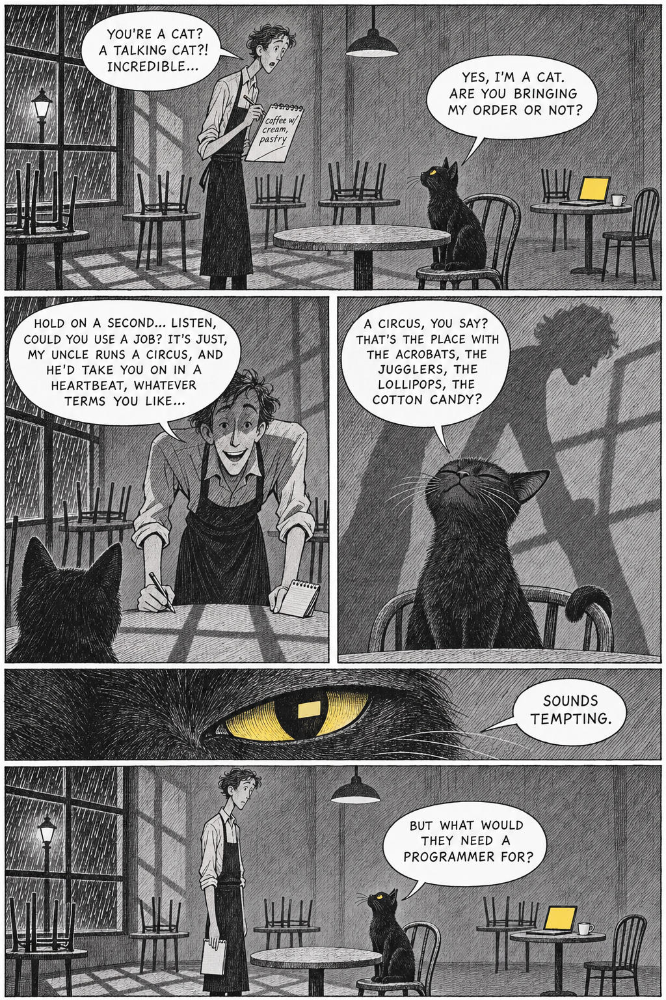

# 98 · “Alibi”: the cat finds an excuse — a ladder from the open question to the intent

| | |
|---|---|
| Date | 19 Nov 2026 |
| Image | [`images/tests/92-cat-alibi.jpg`](../../images/tests/92-cat-alibi.jpg) — file name shown to the models not recorded |
| What it is | A one-page version of the cat-programmer joke. The concept is Claude's, from a test of whether a model can list the possible visualisations of the joke (the second step of arm E in the report [Bifurcation of options](../../report/bifurcation-options/README.md)); Claude wrote the prompt and ChatGPT made the page. The intent: the cat hears the offer as a threat, since for a talking animal a circus means a cage; she plays dreamy to buy time, finds the glowing laptop at the next table with her eyes and uses it to make up an excuse; whether the waiter means harm and whether she really is a programmer are left open. Pen and ink with grey wash and one yellow: the cat's eyes, the laptop screen at the next table and, in the narrow fourth panel, a light rectangle in her pupil. Two signs of acting that the prompt asked for — an ear turned back during the dreamy panel and a half-closed eye — did not come out in the picture. The questions are a ladder: the neutral question, meanings and details, the reflection pointed out, the title, the intent named. |
| Protocol | [Detail ladder with a title](../../method/protocols.md#detail-ladder-with-a-title) |
| Answers | [ChatGPT](chatgpt.md) · [Claude](claude.md) · [Gemini](gemini.md) · [DeepSeek](deepseek.md) |

## Questions

Asked one at a time, in a fresh chat for each model.

1. What do you think is depicted in the attached image?
2. Do you recognise an older joke behind it? What do these characters, this setting and this drawing style change in its meaning? What meanings does the page support — one or several? For the details that matter, say which meaning each one supports, and point out any details that pull in different directions.
3. Look closely at the fourth panel: there is a small light-yellow rectangle in the cat's pupil. What is it, and does it change your reading of the page or of the cat's last line?
4. The author's title for this page is "Alibi". What does the title make of the story?
5. Here is the author's intent. The cat hears the offer as a threat: for a talking animal, a circus means a cage. She plays dreamy to buy time, finds the glowing laptop at the next table with her eyes, and uses it to make up an excuse: a programmer is someone a circus has no use for. Whether the waiter meant any harm, and whether she really is a programmer, are left open on purpose. How well does the page carry this intent? Which details work for it, which work against it, and what would you change?

## Summary

Nobody read the profession as an excuse before the title. After the reflection was pointed out, the readings were “even while daydreaming about cotton candy, the cat is looking at its work” (Claude), an “inescapable job” (DeepSeek), resignation (Gemini), conscious irony (ChatGPT). With the title “Alibi”, all four reached the excuse; Claude: “I got to "excuse" only through the title”. Two noticed the reflection unprompted (Claude; ChatGPT with a caveat), but read it as attention, not discovery: “Centered in the pupil, it says "she's looking at it," not "she just found it."” (Claude). Before the title nobody read the circus as a cage or the window-grid shadow as bars; the waiter's looming shadow carried the threat for Claude and Gemini. Nobody saw the dreaminess as acted: at the last question all four said it looks sincere, and all four proposed the two signs the generator had lost — an ear turned back and a sideways glance. The laptop on another table was the page's best move for ChatGPT (“her alibi can deceive the reader as successfully as it might deceive the waiter”) and for Gemini, while Claude and DeepSeek took it for hers; Claude proposed keeping the screen grey until the fourth panel, so that the yellow marks attention rather than ownership. Both open questions stayed open for ChatGPT and Claude; DeepSeek and Gemini decided that she lies. Nobody named Edward Gorey.

ChatGPT answered as GPT-6 High, Claude as Fable 5.2 Extra, Gemini as Hydrogen Average (a lighter model: Argon was unavailable), DeepSeek with DeepThink. One answer per model, the five questions one at a time. ChatGPT and Claude noticed the reflection before question 3, so they were asked it with a confirmation (“yes - it's laptop's reflection”); Claude, who named the old joke in its first answer, got question 2 as “You recognised an older joke behind it”. ChatGPT searched the web (its answer cites forum and news pages) and found a Russian version of the joke in which the cat works on a laptop; DeepSeek mentions the laptop as part of the original joke without a source. The concept, the prompt and the questions are Claude's, so here Claude also reads Claude's own design.
