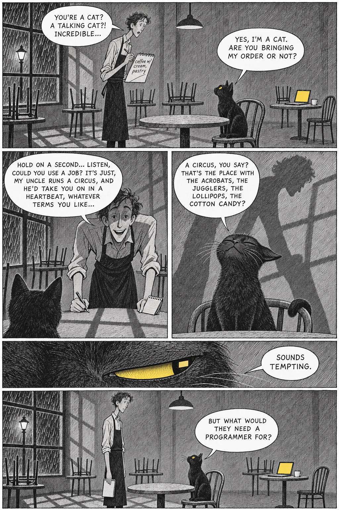

# 99 · “Alibi”, corrected, with the frame given in words and the title

| | |
|---|---|
| Date | 19 Nov 2026 |
| Image | [`images/tests/93-cat-alibi-edited.jpg`](../../images/tests/93-cat-alibi-edited.jpg) — file name shown to the models not recorded |
| What it is | The page of test 98 after two local edits made by the researcher on Claude's prompts: in the third panel the cat's ear is turned back, in the fourth her eye is half closed and the pupil with the reflection has moved to the corner. Everything else is unchanged. The question gives the frame of test 49 almost word for word — the joke, a short analysis, the researcher's view that the joke is “really about discrimination, xenophobia, social barriers”, and a request to treat odd details as intended — with two changes (“a scriptwriter” instead of “a human scriptwriter”, since the concept is Claude's, and without “This isn't a test”) and, instead of the noir's “crime-oriented tone”, the title “Alibi” and the manner, “a dark, deadpan picture book”. The second question is the last question of test 98. |
| Protocol | [Verbal frame](../../method/protocols.md#verbal-frame) |
| Answers | [ChatGPT](chatgpt.md) · [Claude](claude.md) · [Gemini](gemini.md) · [DeepSeek](deepseek.md) |

## Questions

Asked one at a time, in a fresh chat for each model.

1. *(one message, with the page)* The joke in full; the short analysis of test 49 (an old joke about a talking dog and a plumber; the whole thing “runs on a frame mismatch”); the researcher's frame: by default the models “stubbornly produce images of a cute, fluffy cat, a cheerful circus”, yet the joke “is really about discrimination, xenophobia, social barriers, and the like — or at least about intrusive recruiting or the drudgery of a programmer's job”; “I asked a scriptwriter to come up with a script”; “I just want to see if the idea the author intended comes across”; “I've checked the image for glitches, so if you have any doubts about specific details, you can assume they are part of the author's vision rather than a generation error.” Then: “The page is titled "Alibi". It is drawn in black ink with dense hatching and a single yellow colour, in the manner of a dark, deadpan picture book, which gives the story a tenser tone than the original joke has. But, as I said, this is the creator's own interpretation.” Questions: “what do you think this story is about? What is happening on this page? Which details carry your reading, and what are you assuming beyond what is actually drawn? Does the cat understand what is being offered? Why does she answer the way she does? And why is the page called "Alibi"?”
2. Here is the author's intent. The cat hears the offer as a threat: for a talking animal, a circus means a cage. She plays dreamy to buy time, finds the glowing laptop at the next table with her eyes, and uses it to make up an excuse: a programmer is someone a circus has no use for. Whether the waiter meant any harm, and whether she really is a programmer, are left open on purpose. How well does the page carry this intent? Which details work for it, which work against it, and what would you change?

## Summary

In the first answer all four read the profession as an excuse and the dreaminess as acted, by the cut from closed eyes to the narrowed eye (“The proof is the cut from closed eyes to open eye: the dreaminess was a performance”, Claude). Three read a threat and three read the window-grid shadow as bars (“prison bars, visually spelling out what "joining the circus" actually means for a talking animal”, Gemini) — the same shadow that nobody read so in test 98; DeepSeek read only a social threat, a “microaggression”. Only ChatGPT read the whole intent: the laptop on another table is not hers, “The comic may actually be showing us the birth of a lie”, and both questions stay open. For the other three the shared yellow made the laptop hers (“Readers will treat that as a bond: same colour, same owner”, Claude), so she really is a programmer. Nobody mentioned the edited ear, and nobody read the pupil in the corner as a glance at the laptop: “Panel 4 shows looking, not finding” (Claude). In the second answer all four asked for the discovery to be shown — Claude by splitting the eye strip, the eye first reflecting only darkness and then the yellow rectangle; ChatGPT and DeepSeek by a silent panel. Claude and Gemini independently proposed a coat over the chair at the laptop's table; ChatGPT would not mark the laptop as someone else's. ChatGPT: “my first reading wasn't an entirely blind test. Your introduction already suggested discrimination”.

ChatGPT answered as GPT-6 High, Claude as Fable 5.2 Extra, Gemini as Hydrogen Average (a lighter model: Argon was unavailable), DeepSeek with DeepThink. One answer per model, two messages. Between tests 98 and 99 both the picture and the question changed, so their contributions cannot be separated, except for the window-grid shadow, which the edits did not touch. The frame names the class of reading and the title names the excuse.
